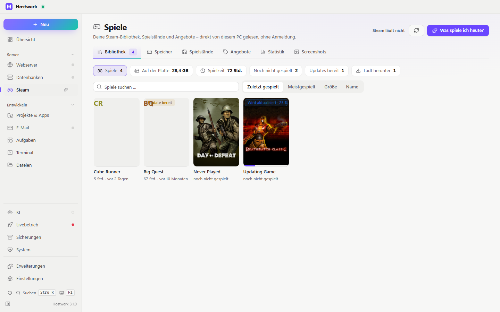

# Spielebibliothek

Alle deine Spiele an einem Ort. Deine Steam-Bibliothek ohne Anmeldung: Spiele, Größe, Laufwerk, Spielzeit und laufende Downloads. Dazu ein Speicher-Doktor, der zeigt, was Platz frisst, Spielstand-Sicherung nach jeder Sitzung (Ludusavi-Liste), Preisalarm für deine Merkliste, Spielzeit-Statistik, Screenshots, „Was spiele ich heute?“ und eigene Server zu deinen Spielen mit einem Klick. Epic Games und GOG liest sie von diesem PC; dein Steam-Konto und itch.io lassen sich einmal verbinden – für gekaufte Spiele, die nicht installiert sind.

[English](README.md) · Offizielle [Hostwerk](https://github.com/Passimoritz/hostwerk-public)-Erweiterung (native Erweiterung, ab Hostwerk 3.0)



## Was sie kann

- **Konten & weitere Shops** (Reiter „Konten“) – einmal verbinden, bleibt verbunden: **Steam** über die offizielle Steam-Anmeldung (OpenID – Hostwerk erfährt nur deine SteamID, nie dein Passwort) plus deinen eigenen kostenlosen Web-API-Schlüssel, **itch.io** mit API-Schlüssel. **Epic Games** und **GOG** liest Hostwerk ohne Anmeldung aus ihren Launchern auf diesem PC. Gekaufte, nicht installierte Spiele stehen unter „Weitere Spiele“ unter der Bibliothek, je Shop filterbar, mit Installieren (Steam), Spielen und Ordner öffnen (Epic, GOG) oder Link (itch.io). Frischt sich alle 6 Stunden selbst auf; Schlüssel liegen verschlüsselt und kommen nie im Browser an.
- **Bibliothek ohne Konto** – findet Steam selbst (Windows-Registry und übliche Ordner, unter Linux `~/.steam`, `~/.local/share/Steam`, Flatpak, Snap) und liest jede Bibliothek auf jedem Laufwerk: installierte Spiele mit Cover, Größe, Laufwerk, Build, Update-Stand, Download-Fortschritt live, Spielzeit und „zuletzt gespielt“ je Steam-Konto. Die Cover kommen aus Steams eigenem Bild-Zwischenspeicher auf diesem PC; nur Fehlendes holt Hostwerk einmal von Steams CDN.
- **Steam-Zustand** – läuft Steam, welches Spiel läuft gerade, was lädt gerade herunter (mit Prozent) und wann Steam ein Update eingeplant hat.
- **Speicher-Doktor** – eine Platz-Karte je Laufwerk (größte Spiele als Streifen) und Befunde: nie gestartet, lange nicht gespielt (Standard 180 Tage), viel gespielt, liegt aber auf einer Festplatte, obwohl die SSD Platz hätte, Laufwerk fast voll, Reste deinstallierter Spiele (Workshop, Shader-Cache, Proton-Präfix, abgebrochene Downloads). Hostwerk löscht nichts selbst: Deinstallieren öffnet Steams eigenen Dialog, Reste öffnen sich im Dateimanager.
- **Spielstand-Zeitmaschine** – wo ein Spiel seine Spielstände ablegt, kommt aus der offenen [Ludusavi-Liste](https://github.com/mtkennerly/ludusavi-manifest) (aus dem PCGamingWiki, täglich aktualisiert). Endet ein Spiel, sichert Hostwerk die Spielstände von selbst; jede Datei liegt nur einmal da (unveränderte Spielstände kosten keinen Platz). Zurückspielen legt immer vorher eine Vorab-Sicherung an und geht nicht, solange das Spiel läuft. Zeigt, welche Spiele ihre Spielstände **nur auf diesem PC** haben (ohne Steam Cloud, noch ohne Sicherung). Unter Linux sucht Hostwerk bei Windows-Spielen auch im Proton-Präfix. Die Sicherungen erscheinen in Hostwerks Sicherungs-Zentrale und in der externen Sicherung.
- **Angebote & Merkliste** – Spiele über die Steam-Shop-Suche hinzufügen oder die öffentliche Steam-Wunschliste übernehmen; aktueller Preis, Rabatt, tiefster gesehener Preis, Preisverlauf, Zielpreis je Spiel, eine gebündelte Benachrichtigung, wenn etwas ins Angebot geht. Dazu der Wert der Bibliothek (heutiger Normalpreis deiner installierten Spiele – ehrlich beschriftet, nicht das, was du bezahlt hast).
- **Was spiele ich heute?** – drei Ideen aus der eigenen Bibliothek nach Stimmung: angefangen, alte Lieblinge, nie gestartet, kurze Runde, mit Freunden (Koop-Kategorien) – „Neu würfeln“ bringt andere. Ohne Konto, ohne KI.
- **Statistik** – Spielzeit je Woche und je Tag, meistgespielt der letzten 30 Tage, Tage am Stück, letzte Sitzungen.
- **Screenshots** – Galerie deiner Steam-Screenshots je Spiel, große Ansicht, Ordner öffnen.
- **Eigener Server zu deinen Spielen** – mit der Erweiterung „Spiele-Server“: erkennt, welche installierten Spiele ein Server-Tool haben, und richtet es mit einem Klick ein (SteamCMD). Erscheint als Reiter „Deine Spiele“ unter Spiele-Server und in den Details eines Spiels.
- **Kachel für die Übersicht** – läuft gerade / zuletzt gespielt, Updates, Downloads, fast volle Laufwerke.

## Installieren

In Hostwerk: **Erweiterungen → Entdecken** und „Installieren“ klicken.

Native Erweiterungen laufen als Teil von Hostwerk (eigener Server- und Oberflächen-Teil). Deshalb installiert Hostwerk sie nur aus dem offiziellen Katalog (mit Prüfsumme) oder im Entwickler-Modus.

## Datenquellen – und warum nichts gepflegt werden muss

| Was | Quelle | Schlüssel? |
|---|---|---|
| Bibliothek, Spielzeit, Downloads, Screenshots, Cover | Steams eigene Dateien auf diesem PC (`libraryfolders.vdf`, `appmanifest_*.acf`, `localconfig.vdf`, `appcache/librarycache`) – nur lesend | nein |
| Wo Spiele ihre Spielstände ablegen | Ludusavi-Liste (raw.githubusercontent.com), höchstens einmal am Tag mit `If-None-Match` (meist 304), gepackt abgelegt | nein |
| Preise, Genres, Suche | Steam-Shop (`store.steampowered.com/api/appdetails`, `storesearch`), gedrosselt, Preise zweimal am Tag | nein |
| Öffentliche Wunschliste | `api.steampowered.com/IWishlistService/GetWishlist` | nein |
| Fehlende Cover | Steams CDN über Hostwerks Bildspeicher | nein |
| Gekaufte Spiele (freiwillig) | `api.steampowered.com/IPlayerService/GetOwnedGames` mit eigenem Web-API-Schlüssel nach der Anmeldung über `steamcommunity.com/openid` | dein eigener |
| itch.io (freiwillig) | `api.itch.io/profile/owned-keys` mit eigenem API-Schlüssel | dein eigener |
| Epic Games, GOG | Manifeste des Epic-Launchers (`*.item`) und die GOG-Einträge in der Windows-Registry – nur lesend | nein |
| Server-Tools | die Erweiterung „Spiele-Server“ (`ctx.games`) – Feature-Erkennung | – |

In der Erweiterung steht keine Spieleliste. Der Offline-Modus wird beachtet: Dann fragt sie nichts im Netz, alles Lokale läuft weiter.

## Rechte

- `native` – liest Steams Dateien und die Spielstand-Ordner, schreibt nur in den eigenen Datenordner; öffnet `steam://`-Links (feste Liste: spielen, Details, deinstallieren, prüfen, Shop …) und Ordner, die die Erweiterung selbst gefunden hat – nur auf deinen Klick.
- `network` – genau diese Adressen: `store.steampowered.com` (Preise, Genres, Suche), `api.steampowered.com` (öffentliche Wunschliste), `shared.akamai.steamstatic.com` und `cdn.cloudflare.steamstatic.com` (Cover, die auf diesem PC fehlen), `raw.githubusercontent.com` (Ludusavi-Liste), `steamcommunity.com` (Steam-Anmeldung bestätigen), `api.itch.io` (deine itch.io-Spiele, nur wenn verbunden).
- `read:games` – sieht die Spiele-Server der Erweiterung „Spiele-Server“ (welcher Server zu einem Spiel schon da ist).

## Grenzen (ehrlich)

- **Keine Erfolge.** Gekaufte, nicht installierte Spiele brauchen die Steam-Anmeldung plus eigenen Web-API-Schlüssel (einen anderen dauerhaften Weg bietet Steam nicht); ohne sie zeigt die Erweiterung, was auf diesem PC installiert ist.
- Die Spielzeit-Statistik beginnt am Tag der Installation (Steam speichert nur Summen). Sitzungen erscheinen, wenn Hostwerk beim Spielen läuft.
- Spielstände in der Windows-Registry (einige ältere Spiele) werden genannt, aber nicht gesichert. Spiele, die in der Ludusavi-Liste fehlen, stehen als „Ort unbekannt“ da.
- `steam://`-Links wirken auf dem PC, auf dem Hostwerk läuft – von einem anderen Gerät aus öffnen sie nichts.
- Preise: Der Shop begrenzt Abfragen ohne Schlüssel; Hostwerk pausiert 15 Minuten, wenn Steam darum bittet. Wunschlisten müssen öffentlich sein.
- Epic und GOG: nur, was auf diesem PC installiert ist (beide bieten keinen dauerhaften offiziellen Weg, ein ganzes Konto aufzulisten). Andere Launcher (EA app, Ubisoft Connect, Battle.net) sind noch nicht dabei.

## Entwickeln

```bash
node --test tests/*.test.js          # Tests (erfundene Steam-Installation, keine echten Daten)
node build-native.js .               # Oberfläche bauen (sdk/build-native.js aus hostwerk-public)
node check.js . --strict             # dieselbe Prüfung wie der Katalog (sdk/check.js)
```

Oberfläche in `ui/src`, Server-Teil in `server/`. Texte im Code sind Englisch, Deutsch steht in `locales/de.json`.

## Lizenz

MIT
